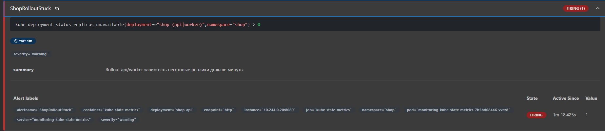

## Часть 1
Для лабораторной выбран Kyverno. Правила в нём пишутся как обычные Kubernetes-манифесты на YAML, поэтому не нужно учить отдельный язык, как Rego в Gatekeeper. 
Он ставится одним Helm-чартом и хорошо работает в локальном кластере. Возможностей Kyverno хватает для всех наших проверок.

Правила и их польза

- Обязательные лимиты ресурсов. Сервис без лимитов может съесть всю память или процессор узла и уронить соседей, а лимиты делают потребление предсказуемым.
- Только доверенный реестр образов (docker.io/library/*). Чужой образ может содержать вредоносный код, а ограничение реестра защищает от подмены и атак через цепочку поставок.
- Обязательные метки (app.kubernetes.io/name, app.kubernetes.io/part-of, owner, env). По меткам можно выбрать всё приложение одной командой, найти владельца при инциденте и отличить окружения.
- Запрет privileged-контейнеров. Такой контейнер почти не изолирован от узла, поэтому запрет закрывает самый короткий путь от взлома контейнера к взлому узла.
- Запуск не от root (runAsNonRoot на уровне пода). Если процесс в контейнере взломан, права обычного пользователя дают атакующему меньше возможностей.

Установим kyverno в кластер и применим политики
```bash
helm repo add kyverno https://kyverno.github.io/kyverno/
helm repo update
helm install kyverno kyverno/kyverno -n kyverno --create-namespace
kubectl apply -f k8s/kyverno/policies.yaml
```
```bash
bob@DESKTOP-VLRMEAB:/mnt/c/Users/bob/GolandProjects/awesomeProject/itmo-devops/lecture-3-kubernetes-control-plane$ kubectl apply -f k8s/kyverno/policies.yaml
Warning: kyverno.io/v1 ClusterPolicy is deprecated and will be removed in a future release; migrate to ValidatingPolicy, MutatingPolicy, GeneratingPolicy or ImageValidatingPolicy (policies.kyverno.io), see https://kyverno.io/docs/guides/migration-to-cel/
clusterpolicy.kyverno.io/require-resource-limits configured
clusterpolicy.kyverno.io/trusted-image-registry configured
clusterpolicy.kyverno.io/require-pod-labels configured
clusterpolicy.kyverno.io/disallow-privileged configured
clusterpolicy.kyverno.io/require-non-root configured
```

Запустим тесты
```bash
bob@DESKTOP-VLRMEAB:/mnt/c/Users/bob/GolandProjects/awesomeProject/itmo-devops/lecture-3-kubernetes-control-plane$ for f in k8s/tests/*.yaml; do echo "== $f"; kubectl apply -f $f; done
== k8s/tests/no-labels.yaml
Error from server: error when creating "k8s/tests/no-labels.yaml": admission webhook "validate.kyverno.svc-fail" denied the request: 

resource Pod/default/no-labels was blocked due to the following policies 

require-pod-labels:
  require-standard-labels: 'validation error: Pod must have labels app.kubernetes.io/name, app.kubernetes.io/part-of, owner and env (dev|staging|prod). rule require-standard-labels failed at path /metadata/labels/'
== k8s/tests/no-limits.yaml
Error from server: error when creating "k8s/tests/no-limits.yaml": admission webhook "validate.kyverno.svc-fail" denied the request: 

resource Pod/default/no-limits was blocked due to the following policies 

require-resource-limits:
  require-cpu-and-memory-limits: 'validation error: Container must define CPU and memory limits. rule require-cpu-and-memory-limits failed at path /spec/containers/0/resources/limits/'
== k8s/tests/privileged.yaml
Error from server: error when creating "k8s/tests/privileged.yaml": admission webhook "validate.kyverno.svc-fail" denied the request: 

resource Pod/default/privileged was blocked due to the following policies 

disallow-privileged:
  no-privileged-containers: 'validation error: Privileged containers are forbidden. rule no-privileged-containers failed at path /spec/containers/0/securityContext/privileged/'
== k8s/tests/run-as-root.yaml
Error from server: error when creating "k8s/tests/run-as-root.yaml": admission webhook "validate.kyverno.svc-fail" denied the request: 

resource Pod/default/run-as-root was blocked due to the following policies 

require-non-root:
  require-run-as-non-root: 'validation error: Pod must set runAsNonRoot. rule require-run-as-non-root failed at path /spec/securityContext/runAsNonRoot/'
== k8s/tests/untrusted-image.yaml
Error from server: error when creating "k8s/tests/untrusted-image.yaml": admission webhook "validate.kyverno.svc-fail" denied the request: 

resource Pod/default/untrusted-image was blocked due to the following policies 

trusted-image-registry:
  only-library-images: 'validation error: Images must come from docker.io/library/. rule only-library-images failed at path /spec/containers/0/image/'
```

---
## Часть 2

Для начала собираем докер образы и загружаем их в кластер

```bash
docker build -f k8s/build/Dockerfile --build-arg SERVICE=api -t docker.io/library/shop-api:1.0.0 .
docker build -f k8s/build/Dockerfile --build-arg SERVICE=worker -t docker.io/library/shop-worker:1.0.0 .
kind load docker-image docker.io/library/shop-api:1.0.0 docker.io/library/shop-worker:1.0.0 --name lab3
```

Затем установим Чарт и проверим, что поды поднялись
```bash
bob@DESKTOP-VLRMEAB:/mnt/c/Users/bob/GolandProjects/awesomeProject/itmo-devops/lecture-3-kubernetes-control-plane$ helm lint ./k8s/helm/shop
==> Linting ./k8s/helm/shop
[INFO] Chart.yaml: icon is recommended

1 chart(s) linted, 0 chart(s) failed
bob@DESKTOP-VLRMEAB:/mnt/c/Users/bob/GolandProjects/awesomeProject/itmo-devops/lecture-3-kubernetes-control-plane$ helm install shop ./k8s/helm/shop -n shop --create-namespace --wait
NAME: shop
LAST DEPLOYED: Sun Oct 11 20:12:29 2026
NAMESPACE: shop
STATUS: deployed
REVISION: 1
TEST SUITE: None
bob@DESKTOP-VLRMEAB:/mnt/c/Users/bob/GolandProjects/awesomeProject/itmo-devops/lecture-3-kubernetes-control-plane$ kubectl get pods -n shop
NAME                           READY   STATUS    RESTARTS   AGE
shop-api-b799bb56b-88mk9       1/1     Running   0          97s
shop-api-b799bb56b-bnmtx       1/1     Running   0          97s
shop-api-b799bb56b-bqr5s       1/1     Running   0          97s
shop-worker-65fbbb4c94-2q4ss   1/1     Running   0          97s
shop-worker-65fbbb4c94-wqbxh   1/1     Running   0          97s
```
Удалим поды api и посмотрим, что они запустятся опять
```bash
bob@DESKTOP-VLRMEAB:/mnt/c/Users/bob/GolandProjects/awesomeProject/itmo-devops/lecture-3-kubernetes-control-plane$ kubectl delete pod -n shop -l app.kubernetes.io/name=api --wait=false
pod "shop-api-b799bb56b-46zpf" deleted from shop namespace
pod "shop-api-b799bb56b-5n557" deleted from shop namespace
pod "shop-api-b799bb56b-xrncb" deleted from shop namespace
bob@DESKTOP-VLRMEAB:/mnt/c/Users/bob/GolandProjects/awesomeProject/itmo-devops/lecture-3-kubernetes-control-plane$ kubectl get pods -n shop
NAME                           READY   STATUS    RESTARTS   AGE
shop-api-b799bb56b-5xkw6       0/1     Running   0          8s
shop-api-b799bb56b-664sv       0/1     Running   0          8s
shop-api-b799bb56b-hr2tw       0/1     Running   0          8s
shop-worker-65fbbb4c94-2q4ss   1/1     Running   0          9m21s
shop-worker-65fbbb4c94-wqbxh   1/1     Running   0          9m21s
bob@DESKTOP-VLRMEAB:/mnt/c/Users/bob/GolandProjects/awesomeProject/itmo-devops/lecture-3-kubernetes-control-plane$ kubectl get pods -n shop
NAME                           READY   STATUS    RESTARTS   AGE
shop-api-b799bb56b-5xkw6       1/1     Running   0          10s
shop-api-b799bb56b-664sv       1/1     Running   0          10s
shop-api-b799bb56b-hr2tw       1/1     Running   0          10s
shop-worker-65fbbb4c94-2q4ss   1/1     Running   0          9m23s
shop-worker-65fbbb4c94-wqbxh   1/1     Running   0          9m23s
```
Обновим replicas на 4 и посмотрим, что добавился один под
```bash
bob@DESKTOP-VLRMEAB:/mnt/c/Users/bob/GolandProjects/awesomeProject/itmo-devops/lecture-3-kubernetes-control-plane$ helm upgrade shop ./k8s/helm/shop -n shop --wait
Release "shop" has been upgraded. Happy Helming!
NAME: shop
LAST DEPLOYED: Sun Oct 11 20:24:24 2026
NAMESPACE: shop
STATUS: deployed
REVISION: 2
TEST SUITE: None
bob@DESKTOP-VLRMEAB:/mnt/c/Users/bob/GolandProjects/awesomeProject/itmo-devops/lecture-3-kubernetes-control-plane$ kubectl get pods -n shop
NAME                           READY   STATUS    RESTARTS   AGE
shop-api-b799bb56b-5xkw6       1/1     Running   0          3m7s
shop-api-b799bb56b-664sv       1/1     Running   0          3m7s
shop-api-b799bb56b-hr2tw       1/1     Running   0          3m7s
shop-api-b799bb56b-mlmvx       1/1     Running   0          26s
shop-worker-65fbbb4c94-2q4ss   1/1     Running   0          12m
shop-worker-65fbbb4c94-wqbxh   1/1     Running   0          12m
```
Теперь сделаем rolling update. Добавим новый докер образ
```bash
docker tag docker.io/library/shop-api:1.0.0 docker.io/library/shop-api:1.1.0
kind load docker-image docker.io/library/shop-api:1.1.0 --name lab3
```
Запустим loadgen и обновим tag в values.yaml на 1.1.0
```bash
bob@DESKTOP-VLRMEAB:/mnt/c/Users/bob/GolandProjects/awesomeProject/itmo-devops/lecture-3-kubernetes-control-plane$ kubectl apply -n shop -f k8s/loadgen.yaml
pod/loadgen created
bob@DESKTOP-VLRMEAB:/mnt/c/Users/bob/GolandProjects/awesomeProject/itmo-devops/lecture-3-kubernetes-control-plane$ helm upgrade shop ./k8s/helm/shop -n shop --wait
Release "shop" has been upgraded. Happy Helming!
NAME: shop
LAST DEPLOYED: Sun Oct 11 20:52:04 2026
NAMESPACE: shop
STATUS: deployed
REVISION: 3
TEST SUITE: None
```
Посмотрим полученные коды сервиса
```bash
bob@DESKTOP-VLRMEAB:/mnt/c/Users/bob/GolandProjects/awesomeProject/itmo-devops/lecture-3-kubernetes-control-plane$ kubectl logs loadgen -n shop | awk '{print $2}' | sort | uniq -c
     45 200
```
Посмотрим все REVISION
```bash
bob@DESKTOP-VLRMEAB:/mnt/c/Users/bob/GolandProjects/awesomeProject/itmo-devops/lecture-3-kubernetes-control-plane$ helm history shop -n shop
REVISION        UPDATED                         STATUS          CHART           APP VERSION     DESCRIPTION     
1               Sun Oct 11 20:12:29 2026        superseded      shop-0.1.0      1.0.0           Install complete
2               Sun Oct 11 20:24:24 2026        superseded      shop-0.1.0      1.0.0           Upgrade complete
3               Sun Oct 11 20:52:04 2026        deployed        shop-0.1.0      1.0.0           Upgrade complete
```
Запустим еще раз нагрузку
```bash
kubectl delete pod loadgen -n shop
kubectl apply -n shop -f k8s/loadgen.yaml
```
Поменяем HEALTH_FAIL на true
```bash
bob@DESKTOP-VLRMEAB:/mnt/c/Users/bob/GolandProjects/awesomeProject/itmo-devops/lecture-3-kubernetes-control-plane$ helm upgrade shop ./k8s/helm/shop -n shop --wait --timeout 90s
Error: UPGRADE FAILED: context deadline exceeded
```
И посмотрим текущее состояние
```bash
bob@DESKTOP-VLRMEAB:/mnt/c/Users/bob/GolandProjects/awesomeProject/itmo-devops/lecture-3-kubernetes-control-plane$ kubectl get pods -n shop -l app.kubernetes.io/name=api
NAME                        READY   STATUS    RESTARTS      AGE
shop-api-599797bd86-n7sjm   0/1     Running   2 (10s ago)   57s
shop-api-7659b88f4f-2r9w7   1/1     Running   0             12m
shop-api-7659b88f4f-lmtcg   1/1     Running   0             11m
shop-api-7659b88f4f-ph2nk   1/1     Running   0             11m
shop-api-7659b88f4f-qdzlp   1/1     Running   0             12m
bob@DESKTOP-VLRMEAB:/mnt/c/Users/bob/GolandProjects/awesomeProject/itmo-devops/lecture-3-kubernetes-control-plane$ kubectl logs loadgen -n shop | awk '{print $2}' | sort | uniq -c
     68 200
```
Откатим все назад
```bash
bob@DESKTOP-VLRMEAB:/mnt/c/Users/bob/GolandProjects/awesomeProject/itmo-devops/lecture-3-kubernetes-control-plane$ helm rollback shop 3 -n shop --wait
Rollback was a success! Happy Helming!
bob@DESKTOP-VLRMEAB:/mnt/c/Users/bob/GolandProjects/awesomeProject/itmo-devops/lecture-3-kubernetes-control-plane$ helm history shop -n shop
REVISION        UPDATED                         STATUS          CHART           APP VERSION     DESCRIPTION                                     
1               Sun Oct 11 20:12:29 2026        superseded      shop-0.1.0      1.0.0           Install complete                                
2               Sun Oct 11 20:24:24 2026        superseded      shop-0.1.0      1.0.0           Upgrade complete                                
3               Sun Oct 11 20:52:04 2026        superseded      shop-0.1.0      1.0.0           Upgrade complete                                
4               Sun Oct 11 21:03:23 2026        failed          shop-0.1.0      1.0.0           Upgrade "shop" failed: context deadline exceeded
5               Sun Oct 11 21:06:48 2026        deployed        shop-0.1.0      1.0.0           Rollback to 3                                   
bob@DESKTOP-VLRMEAB:/mnt/c/Users/bob/GolandProjects/awesomeProject/itmo-devops/lecture-3-kubernetes-control-plane$ kubectl get pods -n shop -l app.kubernetes.io/name=api
NAME                        READY   STATUS    RESTARTS   AGE
shop-api-7659b88f4f-2r9w7   1/1     Running   0          14m
shop-api-7659b88f4f-lmtcg   1/1     Running   0          14m
shop-api-7659b88f4f-ph2nk   1/1     Running   0          14m
shop-api-7659b88f4f-qdzlp   1/1     Running   0          15m
```

---
## Часть 3
Для поднятия CloudNativePG исключим namespace ```cnpg-system``` и ```local-path-storage``` из правил, а также добавим ```ghcr.io/cloudnative-pg/*``` в разрешенные ресурсы

Далее я подготовил шаблон postgres_cluster.yaml для создания кластера PostgreSQL и перезапустил сервис

```bash
helm repo add cnpg https://cloudnative-pg.github.io/charts
helm repo update
helm upgrade --install cnpg cnpg/cloudnative-pg -n cnpg-system --create-namespace --wait
helm uninstall shop -n shop --ignore-not-found
helm install shop ./k8s/helm/shop -n shop --create-namespace --wait --timeout 5m
```

Удалим под Postgres

```bash
bob@DESKTOP-VLRMEAB:/mnt/c/Users/bob/GolandProjects/awesomeProject/itmo-devops/lecture-3-kubernetes-control-plane$ kubectl delete pod -n shop shop-postgres-1
pod "shop-postgres-1" deleted from shop namespace
bob@DESKTOP-VLRMEAB:/mnt/c/Users/bob/GolandProjects/awesomeProject/itmo-devops$ kubectl get pods -n shop
NAME                           READY   STATUS    RESTARTS   AGE
shop-api-779b86478d-27b26      1/1     Running   0          34m
shop-api-779b86478d-mt2d2      1/1     Running   0          34m
shop-api-779b86478d-z7rql      1/1     Running   0          34m
shop-postgres-1                1/1     Running   0          48s
shop-worker-6f6c567f87-kb6zz   1/1     Running   0          34m
shop-worker-6f6c567f87-rg6n6   1/1     Running   0          34m
```

Kube-controller-manager - встроенный компонент Kubernetes. Он следит за встроенными объектами и ничего не знает о конкретных приложениях: пропавший под он просто создаёт заново.

Оператор - тот же цикл сверки spec и status, но для собственного ресурса и с экспертными знаниями о БД: он понимает primary и реплики, диски, пароли и переключение при сбое. Поэтому при удалении пода оператор вернул тот же экземпляр с теми же данными, а не просто новый под.

---
## Часть 4

Остановим etcd и посмотрим что изменения не проходят

```bash
bob@DESKTOP-VLRMEAB:/mnt/c/Users/bob/GolandProjects/awesomeProject/itmo-devops/lecture-3-kubernetes-control-plane$ docker exec lab3-control-plane mv /etc/kubernetes/manifests/etcd.yaml /etc/kubernetes/etcd.yaml.bak
bob@DESKTOP-VLRMEAB:/mnt/c/Users/bob/GolandProjects/awesomeProject/itmo-devops/lecture-3-kubernetes-control-plane$ helm upgrade shop ./k8s/helm/shop -n shop --set api.replicaCount=5 --timeout 20s
Error: UPGRADE FAILED: query: failed to query with labels: the server was unable to return a response in the time allotted, but may still be processing the request (get secrets)
bob@DESKTOP-VLRMEAB:/mnt/c/Users/bob/GolandProjects/awesomeProject/itmo-devops/lecture-3-kubernetes-control-plane$ kubectl get pods -n shop --request-timeout=5s
Unable to connect to the server: net/http: request canceled (Client.Timeout exceeded while awaiting headers)
```

Посмотрим, что приложение живо и сохраняет записи в бд
```bash
bob@DESKTOP-VLRMEAB:/mnt/c/Users/bob/GolandProjects/awesomeProject/itmo-devops/lecture-3-kubernetes-control-plane$ docker exec lab3-control-plane curl -s http://$API/health
okbob@DESKTOP-VLRMEAB:/mnt/c/Users/bob/GolandProjects/awesomeProject/itmo-devops/lecture-3-kubernetes-control-plane$ docker exec lab3-control-plane curl -s http://$API/orders
[{"id":1,"item":"book","quantity":1,"status":"processed","created_at":"2026-10-18T12:10:49.793453Z","processed_at":"2026-10-18T12:10:50.552729Z"}]
bob@DESKTOP-VLRMEAB:/mnt/c/Users/bob/GolandProjects/awesomeProject/itmo-devops/lecture-3-kubernetes-control-plane$ docker exec lab3-control-plane curl -s -X POST http://$API/order -d '{"item":"pen","quantity":3}'
{"id":2,"item":"pen","quantity":3,"status":"pending","created_at":"2026-10-18T12:17:12.767547Z","processed_at":null}
bob@DESKTOP-VLRMEAB:/mnt/c/Users/bob/GolandProjects/awesomeProject/itmo-devops/lecture-3-kubernetes-control-plane$ docker exec lab3-control-plane curl -s http://$API/orders
[{"id":1,"item":"book","quantity":1,"status":"processed","created_at":"2026-10-18T12:10:49.793453Z","processed_at":"2026-10-18T12:10:50.552729Z"},{"id":2,"item":"pen","quantity":3,"status":"processed","created_at":"2026-10-18T12:17:12.767547Z","processed_at":"2026-10-18T12:17:14.279153Z"}]
```

Восстановим etcd 
```bash
bob@DESKTOP-VLRMEAB:/mnt/c/Users/bob/GolandProjects/awesomeProject/itmo-devops/lecture-3-kubernetes-control-plane$ docker exec lab3-control-plane mv /etc/kubernetes/etcd.yaml.bak /etc/kubernetes/manifests/etcd.yaml
bob@DESKTOP-VLRMEAB:/mnt/c/Users/bob/GolandProjects/awesomeProject/itmo-devops/lecture-3-kubernetes-control-plane$ kubectl get pods -n shop
NAME                           READY   STATUS    RESTARTS   AGE
shop-api-779b86478d-27b26      1/1     Running   0          66m
shop-api-779b86478d-mt2d2      1/1     Running   0          66m
shop-api-779b86478d-z7rql      1/1     Running   0          66m
shop-postgres-1                1/1     Running   0          33m
shop-worker-6f6c567f87-kb6zz   1/1     Running   0          66m
shop-worker-6f6c567f87-rg6n6   1/1     Running   0          66m
```

---
## Чать 5

В Helm-чарт добавлены ServiceMonitor и PrometheusRule с тремя алертами:
- ShopRolloutStuck - неготовые реплики api/worker более 1 минуты
- ShopPodRestarting - более 2 рестартов контейнера за 5 минут
- ShopPostgresDown - отсутствие готового PostgreSQL пода более 1 минуты

Применение правил
```bash
helm template shop ./k8s/helm/shop -n shop \
  -f ./k8s/helm/shop/values.yaml \
  --show-only templates/prometheusrule.yaml \
  > /tmp/shop-prometheusrule.yaml

kubectl apply -f /tmp/shop-prometheusrule.yaml
```

Стопнем под
```bash
bob@DESKTOP-VLRMEAB:/mnt/c/Users/bob/GolandProjects/awesomeProject/itmo-devops/lecture-3-kubernetes-control-plane$ kubectl set env deployment/shop-api -n shop HEALTH_FAIL=true
deployment.apps/shop-api env updated
```

В итоге алерт сработал

