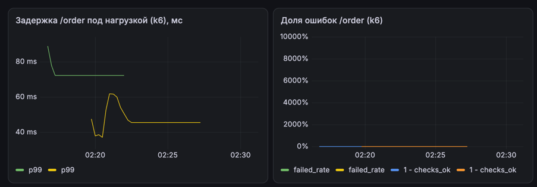
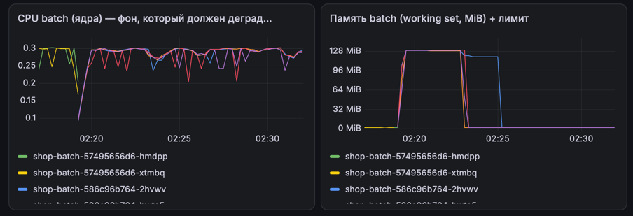
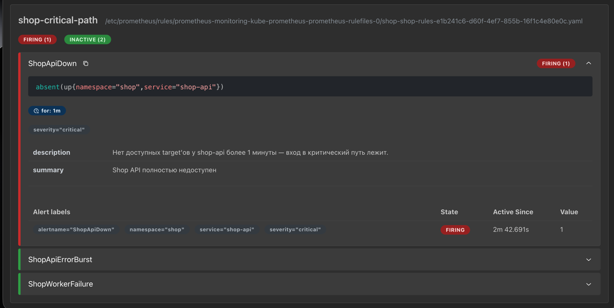
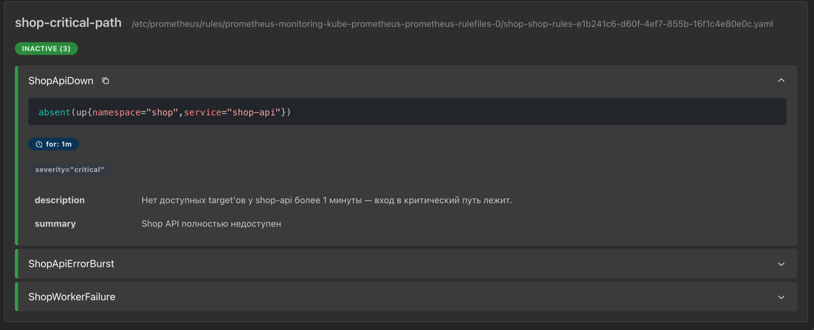

# Лаба 4 — Планирование и ресурсы

# Часть 0 — Сервис batch

Чтобы было на ком демонстрировать вытеснение под перегрузкой, создадим сервис, который занимает память и процессор, но не выполняет полезной работы.
Эту роль играет `batch` — имитация фоновой ночной аналитики.

Он просто крутит CPU вхолостую и занимает память. Число горутин и объем
памяти задаются переменными окружения:

```text
BATCH_CPU_WORKERS   сколько горутин жгут CPU
BATCH_MEM_MB        сколько МБ памяти выделить
```

# Часть 1 — Выбери механизм разнесения

Анти-аффинити — это правило «мой под не сядет рядом с таким же». Оно либо
выполняется, либо нет: под ищет ноду, где нет его «близнеца» с той же меткой.

`topologySpread` — правило про баланс. Ему все равно, стоят ли поды на одной
ноде; важно не дать одной ноде набрать заметно больше подов, чем соседняя.
Допустимую разницу задает `maxSkew`.

Реплик у `api` три, а нод две. Если взять анти-аффинити как жесткий запрет, на эти две ноды больше двух подов
физически не влезает — третьему негде встать, и он зависает в `Pending`
навсегда. Симптом тот же, что при нехватке ресурсов, но причина другая:
освободи место — и все равно не пустит, потому что запрещено самой топологией.

С `topologySpread` эта же тройка ложитс я без проблем: `maxSkew: 1` разрешает
раскладку `2+1`, то есть одна нода может нести на один под больше другой.
Тут никакого застревания из-за самой топологии нет, выбираем этот вариант.

# Часть 2 — Тесная площадка

Площадку делаю маленькой (две ноды), чтобы нехватку ресурсов было
легко получить. Обе ноды делаю рабочими: с control-plane снят taint (`kind-config.yaml`), иначе поды могли бы жить только
на worker, и вторая нода была бесполезна.

```bash
kind create cluster --name lab4 --config k8s/kind-config.yaml
kubectl get nodes -o custom-columns='NAME:.metadata.name,STATUS:.status.conditions[-1].type,TAINTS:.spec.taints'
```
```text
NAME                 STATUS   TAINTS
lab4-control-plane   Ready    <none>
lab4-worker          Ready    <none>
```

Вернула Kyverno с политиками, оператор
CloudNativePG и мониторинг (`kube-prometheus-stack` из Лабы 2). 

`batch` добавляем в чарт новым шаблоном и блоком в `values.yaml` — это
Burstable-под с лимитами (гвардрейлы требуют явные cpu+memory limits, они есть):

```yaml
batch:
  enabled: true
  replicaCount: 2
  image:
    repository: batch
    tag: "0.2.2"
  resources:
    requests: {cpu: 100m, memory: 128Mi}
    limits:   {cpu: 200m, memory: 256Mi}
```

Ставлю `shop`:

```bash
helm upgrade --install shop k8s/helm/shop -n shop --create-namespace --wait
```
```text
# helm upgrade --install shop k8s/helm/shop -n shop --create-namespace --wait --timeout 15m
NAME: shop
STATUS: deployed
REVISION: 2
DESCRIPTION: Upgrade complete

# kubectl get cluster -n shop
NAME            INSTANCES   READY   STATUS                     PRIMARY
shop-postgres   1           1       Cluster in healthy state   shop-postgres-1
```

Текущая картина подов:

```text
# kubectl get pods -n shop -o wide
NAME                          READY   STATUS    RESTARTS   AGE     NODE
shop-api-7c8df85c5f-2mjgm     1/1     Running   0          11m     lab4-worker
shop-api-7c8df85c5f-755fg     1/1     Running   0          11m     lab4-control-plane
shop-api-7c8df85c5f-pdbtr     1/1     Running   0          11m     lab4-control-plane
shop-batch-c6cdd4bc9-q54fk    1/1     Running   0          11m     lab4-control-plane
shop-batch-c6cdd4bc9-xlp68    1/1     Running   0          11m     lab4-worker
shop-postgres-1               1/1     Running   0          61s     lab4-control-plane
shop-worker-6b86555d45-nvk26  1/1     Running   0          11m     lab4-control-plane
shop-worker-6b86555d45-xn5rg  1/1     Running   0          11m     lab4-worker
```

Тесная площадка на 2 ноды готова.

# Часть 3 — Реальные числа вместо угадывания

До этого requests/limits были из прошлых лаб, теперь будем получать реальные числа. Для этого нагружаю сервис
(`k6` по `/order`,  10 VU/3m) и прогоняю
рекомендатор ресурсов `krr` по моему namespace (чтобы не ждать час  уменьшаю количество точек `--points_required 20`):

```bash
krr simple -n shop --cpu_percentile 95 --mem_percentile 95 \
  --container api,worker,batch --points_required 20
```

```text
┌─────────┬─────────────────────┬─────────────────────┐
│ Workload│  CPU requests       │  Memory requests    │
├─────────┼─────────────────────┼─────────────────────┤
│ api     │ 10m                 │ 100Mi               │
│ batch   │ 202m                │ 151Mi               │
│ worker  │ 10m                 │ 100Mi               │
└─────────┴─────────────────────┴─────────────────────┘
```

Postgres `krr` не видит (это не Deployment, а CRD-кластер CNPG), поэтому его
requests считаю руками по Prometheus — 99-й перцентиль CPU и максимальный
working set памяти:

```bash
# 99-й перцентиль CPU (в ядрах) за последний час
kubectl -n monitoring port-forward svc/prometheus-operated 9090:9090 &
curl -s 'http://localhost:9090/api/v1/query?query=quantile_over_time(0.99,
  rate(container_cpu_usage_seconds_total{namespace="shop",container="postgres"}[5m])[1h:])'
# 0.0236 ядра ≈ 24m
# max working set памяти
curl -s 'http://localhost:9090/api/v1/query?query=max_over_time(
  container_memory_working_set_bytes{namespace="shop",container="postgres"}[1h:])'
# 74121216 байта ≈ 70.7 MiB
```

Сравним догадки и то, что реально поставила `krr`:

| Workload | Было (догадка) | KRR/расчет | Поставили requests | limits |
|---|---|---|---|---|
| api | 100m / 128Mi | 10m / 100Mi | 10m / 100Mi | 500m / 100Mi |
| worker | 50m / 64Mi | 10m / 100Mi | 10m / 100Mi | 250m / 100Mi |
| batch | 100m / 128Mi | 202m / 151Mi | 202m / 151Mi | 300m / 151Mi |
| postgres | 100m / 256Mi | 30m / 88Mi | 30m / 88Mi | 500m / 88Mi |

request беру из рекомендации, а CPU-лимит оставляю (krr
советует его убрать, но гвардрейлы требуют явный лимит — так что не трогаю
по CPU). 

```text
# helm upgrade --install shop k8s/helm/shop -n shop --wait
NAME: shop
STATUS: deployed
REVISION: 3

# kubectl get pods -n shop
NAME                          READY   STATUS    RESTARTS   AGE
shop-api-5b6b7d9d8c-mrhnq     1/1     Running   0          3m23s
shop-api-5b6b7d9d8c-q4mx2     1/1     Running   0          3m35s
shop-api-5b6b7d9d8c-vz24g     1/1     Running   0          3m11s
shop-batch-5b96df6b67-gg6rr   1/1     Running   0          3m33s
shop-batch-5b96df6b67-xd4fj   1/1     Running   0          3m35s
shop-postgres-1               1/1     Running   0          31s
shop-worker-7f8b5d979d-bvkls  1/1     Running   0          3m35s
shop-worker-7f8b5d979d-rr599  1/1     Running   0          3m23s
```

Главный вывод: `api` и `worker` жрут сильно меньше, чем им давали (100m против
фактических 10m), а `batch` наоборот недодали (100m против нужных 202m) — это
он CPU молотит вхолостую.

# Часть 4 — Разнеси критический сервис

Применяю выбранный в Части 1 механизм — `topologySpreadConstraints` — к
шаблону `api`:

```yaml
topologySpreadConstraints:
  - maxSkew: 1
    topologyKey: kubernetes.io/hostname
    whenUnsatisfiable: DoNotSchedule
    labelSelector:
      matchLabels:
        app.kubernetes.io/name: api
        app.kubernetes.io/instance: shop
```

Разница по числу подов с меткой`api` между самой загруженной и самой свободной не должна превышать `maxSkew`. 

`DoNotSchedule` - если выдержать нельзя, под остается `Pending`, а не прибивается на переполненную ноду.

Проверяю раскладку:

```bash
kubectl get pods -n shop -l app.kubernetes.io/name=api -o wide
```

```text
NAME                        READY   STATUS    NODE
shop-api-5b6b7d9d8c-mrhnq   1/1     Running   lab4-worker
shop-api-5b6b7d9d8c-q4mx2   1/1     Running   lab4-worker
shop-api-5b6b7d9d8c-vz24g   1/1     Running   lab4-control-plane
```

Три реплики `api` разложились `2+1`: на worker две, на control-plane одна.
Правило в ReplicaSet на месте:

```text
["labelSelector":{... "app.kubernetes.io/name":"api"}, "maxSkew":1,
 "topologyKey":"kubernetes.io/hostname","whenUnsatisfiable":"DoNotSchedule"]
```

`maxSkew: 1` позволяет разницу в один под, поэтому `2+1` — допустимо, а `3+0`
уже нет: третья реплика не села бы на уже занятую ноду, а дождалась бы
свободной.

Если бы все три реплики `api` висели на одной ноде, отказ этой ноды уронил бы сервис целиком. Разнесение на две зоны отказа
значит, что падение одной ноды оставляет по крайней мере одну живую реплику.

# Часть 5 — Приоритеты и гарантии

1) Ввожу два класса приоритета: высокий для критического пути и низкий
для `batch`:

```yaml
priorityClasses:
  - name: shop-critical   # api
    value: 1000
  - name: shop-batch      # batch — НИЖЕ дефолта (0)
    value: -10
```

2) `podDisruptionBudgets` у `api` — чтобы при добровольном сбое сервис не терял больше одной реплики:

```yaml
podDisruptionBudgets:
  api:
    enabled: true
    minAvailable: 2
```

3) QoS - устанавливаю requests == limits для критического пути - класс
Guaranteed, `batch` оставляю Burstable:

```yaml
# api
requests: {cpu: 250m, memory: 128Mi}
limits:   {cpu: 250m, memory: 128Mi}
# postgres
requests: {cpu: 250m, memory: 512Mi}
limits:   {cpu: 250m, memory: 512Mi}
# batch — requests заметно ниже limits
requests: {cpu: 202m, memory: 151Mi}
limits:   {cpu: 300m, memory: 256Mi}
```


```bash
kubectl get pods -n shop -o custom-columns='NAME:.metadata.name,QOS:.status.qosClass,PRIORITY:.spec.priority,PRIORITYCLASS:.spec.priorityClassName,RESTARTS:.status.containerStatuses[0].restartCount'
```

```text
NAME                           QOS         PRIORITY   PRIORITYCLASS   RESTARTS
shop-api-74f8688dcf-4kj6d      Guaranteed  1000       shop-critical   0
shop-api-74f8688dcf-xmn6v      Guaranteed  1000       shop-critical   0
shop-api-74f8688dcf-xwm97      Guaranteed  1000       shop-critical   0
shop-batch-57495656d6-m6526    Burstable   -10        shop-batch      0
shop-batch-57495656d6-x62pd    Burstable   -10        shop-batch      0
shop-postgres-1                Guaranteed  0          <none>          0
shop-worker-7f8b5d979d-bvkls   Burstable   0          <none>          0
shop-worker-7f8b5d979d-rr599   Burstable   0          <none>          0
```

PDB и классы на месте:

```text
NAME                    MIN AVAILABLE   ALLOWED DISRUPTIONS
shop-api                2               1
shop-postgres-primary   1               0
shop-worker             1               1

NAME            VALUE   PREEMPTIONPOLICY
shop-batch      -10     PreemptLowerPriority
shop-critical   1000    PreemptLowerPriority
```

при давлении на память kubelet вытесняет (evict) поды в
порядке BestEffort → Burstable → Guaranteed. `api` и `postgres` —
Guaranteed, значит kubelet тронет их в последнюю очередь. А если места не
хватает еще на этапе планирования, в дело вступает preemption по приоритету —
тут `batch` с `-10` проигрывает

# Часть 6 — Создай нехватку, поймай preemption

Создаю нехватку CPU по requests и ловлю обе стадии: когда вытеснять некого и когда вытесняют.

Ноды у нас по 2 CPU. Начинаем с фактической картины — control-plane уже на
95% request'ов, у worker есть запас:

```text
NAME                 CPU_ALLOC
lab4-control-plane   2         # requests cpu 1912m (95%)
lab4-worker          2         # requests cpu 962m (48%)
```

1) Упираемся в CPU: поднимаю `batch` до 8 реплик (каждая по 202m
request). Часть влезает, но одна упирается:

```bash
kubectl scale deployment shop-batch -n shop --replicas=8
kubectl get pods -n shop -l app.kubernetes.io/name=batch   # 7×Running, 1×Pending
kubectl describe pod shop-batch-57495656d6-j9s8w | sed -n '/Events:/,$p'
```

```text
Warning  FailedScheduling  default-scheduler
  0/2 nodes are available: 2 Insufficient cpu.
  preemption: 0/2 nodes are available: 2 No preemption victims found for incoming pod.
```

Видно, что под `Insufficient cpu`, но preemption не сработал —
`No preemption victims`. Входящий под — сам `batch` с приоритетом `-10`, ниже
него никого нет, вытеснять некого. Preemption при этом — не то же самое, что
eviction: планировщик просто не находит жертв ниже по приоритету.

2) Высокоприоритетный под: создаю под `spike` с
`priorityClassName: shop-critical` (1000) и CPU request 800m — ему тоже некуда
встать, но в отличие от `batch` он может вытеснять:

```bash
kubectl run spike ... --priority shop-critical ... requests cpu=800m
kubectl get events -n shop --sort-by=.lastTimestamp
```

```text
Warning  FailedScheduling  pod/spike
  ... preemption: found a potential placement for pod on node lab4-worker, preempting 4 victims

Normal   Preempted         pod/shop-batch-...-q4t2t   Preempted by pod 814d... on node lab4-worker
Normal   Preempted         pod/shop-batch-...-snclx   Preempted by pod 814d... on node lab4-worker
Normal   Preempted         pod/shop-batch-...-wjjt5   ... (и еще)
Normal   Preempted         pod/shop-batch-...-z8n9j   ...
Normal   Scheduled         pod/spike                   Successfully assigned shop/spike to lab4-worker
```

Планировщик для `spike` нашел жертв — вытеснил 4 пода `batch` на
`lab4-worker`, освободил место и встал сам. Это и есть preemption: под с более
высоким приоритетом выбивает поды с более низким, чтобы сесть в уже забитый
кластер.

# Часть 7 — Давление по памяти, порядок жертв

Хотелось поймать выселение по памяти (событие `Evicted` от kubelet)
именно у `batch`, показав, что `api`/`postgres` (Guaranteed) переживают давку.
На это ушло **очень-очень-очень много времени** 

## Попытки несчастные

**1. Два гигантика по 5.5Gi, лимит 6Gi.** `BATCH_MEM_MB=5500`, реплик 2.
Результат: `OOMKilled` — каждый под упирается в **собственный** cgroup-лимит
6Gi (5.5Gi аллокация + рантайм Go не влезают). Давления на ноду нет, eviction
не происходит.

**2. Один на 7Gi, лимит 9Gi.** Лимит выше ноды, но темп аллокации (~67MiB/с)
быстрый: последние гигабайты нода теряет мгновенно, ядро успевает убить раньше
kubelet → `OOMKilled`:

```text
# kubectl get pods -n shop -o wide
NAME                           READY   STATUS      RESTARTS   NODE
shop-api-74f8688dcf-4kj6d      1/1     Running     0          lab4-control-plane
shop-batch-6994bc5b68-zr7x7    0/1     OOMKilled   2          lab4-worker
shop-postgres-1                1/1     Running     0          lab4-control-plane
```

Попутно у `api`/`worker`/`postgres` на обеих нодах массовые таймауты
liveness — хост kind уходит в перегруз. Причина: batch жжет CPU
(`BATCH_CPU_WORKERS=1`) плюс копирует гигабайты — общий хост кончается.

**3. Замедление темпа (правка `batch/main.go`: сон 30→100→250ms).** С одним
медленным гигантом по-прежнему либо OOM-гонка в конце, либо хост-thrash.
Сама регистрация `Evicted` так и не происходит.

**4. Схема много умеренных пожирателей** 4 реплики по
700Mi. У меня все 4 сели:

```text
# container_memory_working_set_bytes (batch)
{
  "pod": "shop-batch-...-tgdnh", "MiB": 704.27
  "pod": "shop-batch-...-pmjwl", "MiB": 705.29
  "pod": "shop-batch-...-r6blc", "MiB": 705.32
  "pod": "shop-batch-...-p5d42", "MiB": 705.38
}   # суммарно ~2.8Gi

# kubectl describe node lab4-worker | grep MemoryPressure
MemoryPressure  False   # нода 7.7Gi — 2.8Gi не давит, eviction не включается
```
Но до порога далеко, подбирала значения дальше.
У нас нода 7.7Gi → 4×700 = 2.8Gi

**5. 4 × 1750Mi (лимит 2Gi, request 64Mi).** Суммарно ~6.8Gi ≈ нода. На
последних гигабайтах снова: ядро OOM'ит `batch` (под мониторингом wss доходил
до ~4Gi и валился) + шторм probe'ов на обеих нодах, потому что давка снова
задевает общий хост. Зафиксировано: `RESTARTS 1` у batch, `MemoryPressure False`.

## Попытка счастливая: порог evictionHard.memory.available

Все попытки выше упирались в одно: **дефолтный порог kubelet `memory.available` —
это 100Mi** (в `config.yaml` его вообще не было, kubelet брал внутренний дефолт).
То есть kubelet начинал «видеть» нехватку памяти только когда свободно меньше
100Mi — а к этому моменту ядро уже успевало OOM-нуть последние аллокации. Kubelet
просыпался слишком поздно, и выигрывал kernel OOM killer.

Починила это на worker-ноде: подняла порог в конфиге kubelet до **1Gi** и
перезапустила kubelet:

```bash
docker exec lab4-worker sh -c 'sed -i "/nodefs.inodesFree: 0%/a\  memory.available: 1Gi" /var/lib/kubelet/config.yaml'
docker exec lab4-worker systemctl restart kubelet
```

Проверила, что порог применился в рантайме — через
`/configz` kubelet подтвердил `"memory.available": "1Gi"`.

Одиночный на 6Gi (BATCH_MEM_MB=6000, лимит 7Gi, CPU выключен) дожал хост до `free ≈ 142Mi`,
kubelet зафиксировал давление и выселил `batch` штатно — событием с
`reason=Evicted`, а не `ContainerOOM`:

```text
# kubectl get pods -n shop -o wide | grep batch
shop-batch-6f68c8fd4d-ksznn  0/1   Evicted   0   ...   lab4-worker
# kubectl get events -n shop --sort-by=.lastTimestamp | grep -i evicted
Warning  Evicted  pod/shop-batch-6f68c8fd4d-ksznn
```

kubelet отправляет `SIGTERM` + grace, выселяет по порядку
QoS (BestEffort → Burstable → Guaranteed) — поэтому `api` и `postgres`
(Guaranteed) не тронуты, а жертвой стала именно фоновая нагрузка. Отличие от
прошлых попыток: убивал не ядро (OOMKilled), а kubelet выселил под штатно.

# Часть 8 — Докажи SLA под нагрузкой

## Формулировка SLA

Критический путь — `POST /order` (api → postgres). Сформулировала и зафиксировала
 SLA:

| Показатель | Порог SLA |
|---|---|
| Доступность (доля успешных ответов) | **≥ 99%** |
| Задержка p95 | **< 300мс** |
| Задержка p99 | **< 500мс** |

Проверка — `k6` по `/order` (10 VU, 3 мин, чек `order 201` = успешный заказ),
нагрузка гонялась через порт-форвард на `svc/shop-api`. SLA считаю по k6-чеку
(доступность) и по перцентилям `http_req_duration`.

## Базлайн (12:00, без перегрузки)

```text
checks: 16877/16877 = 100%   http_req_failed: 0.00%
http_req_duration: avg=6.17ms  med=3.97ms  p(95)=15.29ms  max=273ms
```

На пустом кластере путь дешевый: полезную нагрузку, локальный postgres,
10 VU не создают конкуренции. диск/CPU не нагружены, поэтому даже
`max=273мс` — единичный хвостовой выброс (GC/пауза рантайма), далекий от порога.

## Перегрузка: деградация batch, путь держится

Перегрузку делала на `batch`. Два прогона:

1) бюджетная перегрузка: 4 реплики по 3 CPU-воркера, но лимит
`cpu 300m` режет каждого до 0.3 ядра.

2) усиленная перегрузка: 6 реплик по 3 CPU-воркера, лимит `cpu 2000m` — batch
реально жрет ядра (до ~12 на общем хосте).

| Метрика SLA | Базлайн | A (4×300m) | B (6×2000m) |
|---|---|---|---|
| Доступность | 100% | 100% | 100% |
| p95 | 15.29мс | 17.69мс | 17.24мс |
| p99 ≤ max | 273мс | 572мс | 612мс |
| avg | 6.17мс | 7.04мс | 7.39мс |

SLA держится во всех прогонах: доступность 100% ≥ 99%, p95 ~17мс ≪
300мс, p99 ≤ 612мс — над порогом 500мс во втором за счет хвоста).

- p95 стоит ~17мс, а *хвост растет (273 → 572 → 612мс): loading
  batch давит только на ту реплику api, что живет на той же ноде, что и batch.
- Причина — планирование: `topologySpread` разносит 3 api по 2 нодам (2 на control-plane, 
1 на worker), `postgres` на control-plane,
  а `batch` с крошечным request (202m) сбивается весь на worker — там больше
  allocatable. Получается бьет по одной реплике из трех, 2/3 трафика идет через
  недогруженный control-plane → медиана не двигается, двигается только `max`.
- Защищенный и разнесенный критический путь не пробивается, а фон при этом деградирует.

## Деградация batch (фон), метрикой

В первом прогоне batch хочет 3 ядра, получает 0.3:

```text
# CPU usage на под (намного ниже желаемого — сидит на «потолке» лимита)
container_cpu_usage_seconds_total{namespace="shop",container="batch"} → ~0.27 ядра
# Throttling: cgroup режет периоды
container_cpu_cfs_throttled_periods_total → ~8-9 периодов/с на под
```

То есть batch **насыщен у лимита и systematically throttled** — фоновый
деградирует, критический путь держит SLA.

## Граница перегрузки — она же доказательство тяжести

Второй прогон (6×2000m) был настолько тяжелым, что положил **наш же мониторинг**,
который тоже сидит на worker:

```text
monitoring-kube-prometheus-operator-...         0/1 CrashLoopBackOff (17)
prometheus-monitoring-kube-prometheus-prometheus-0  1/2 Running (7 рестартов)
monitoring-prometheus-node-exporter-worker       1/1 Running (10 рестартов)
```

Порт-форвард на Prometheus начал отдавать `Service Unavailable`, и
CNPG-webhook (тоже на worker) лег → `connect refused` → fail-closed дедлок на
записи. Все это — **побочный, но убедительный признак реальной перегрузки**:
`/order` устоял при давлении, от которого упал собственный мониторинг-стек.

## Графики (Grafana)

Данные для графиков собирала так: k6 писал временные серии прямо в Prometheus
через remote-write (`k6_http_req_duration_*`, `k6_http_req_failed_rate`,
`k6_checks_rate`), а дашборд **«Shop /order SLA (Part 8)»** провижинил через
ConfigMap (sidecar `grafana_dashboard=1`). Скриншоты — с этого дашборда за окно
перегрузки первого прогона (4×300m).

Задержка и ошибки `/order` под перегрузкой — низкая ровная линия p95/p99,
ошибок нет:



Фон при этом деградирует: CPU batch в том же окне растет (4 реплики
молотят ядра на worker), а путь заказа держится:



# Часть 9 — Мониторинг

Добавила в чарт `shop` шаблоны `ServiceMonitor`/`PrometheusRule` и завязала их на
стек из Лабы 2 (Prometheus/Grafana/Alertmanager в namespace `monitoring`).

## Источник метрик

У `api`/`worker` не было `/metrics` — доработала оба сервиса (`prometheus/client_golang`):
- `api`: `shop_api_requests_total{code,route}` + `shop_api_request_duration_seconds`
  (RED), хендлер `/metrics`;
- `worker`: `shop_worker_errors_total` (счетчик ошибок асинхронной обработки),
  `/metrics`.

`ServiceMonitor` (`shop-api` / `shop-worker`) скребет эти `/metrics`; для
`api` подтвердила через API Prometheus, что все 3 таргета живые (`up == 1`).
Правила подхвачены (проверила `GET /api/v1/rules?type=alert`).

## 3 алерта и обоснование

| Алерт | Выражение | Окно | Severity | Зачем |
|---|---|---|---|---|
| `ShopApiDown` | `absent(up{service="shop-api"})` | 1м | **critical** | минута без единого доступного target api = полный отказ входа в критический путь |
| `ShopApiErrorBurst` | `sum(increase(shop_api_requests_total{code=~"5.."}[2m])) >= 5` | 1м | warning | `api` еще up, но уже деградирует (всплеск 5xx) |
| `ShopWorkerFailure` | `increase(shop_worker_errors_total[5m]) >= 1` | 1м | **critical** | ответ `api` сам по себе не гарантирует, что заказ обработан worker'ом асинхронно |

## Провоцирование firing и восстановление

Спровоцировала критический алерт `ShopApiDown` — временно обнулила `api`
(`kubectl scale deploy shop-api --replicas=0 -n shop`). Алерт стал
`pending` затем `firing`:



Затем вернула `api` в 3 реплики — алерт корректно разрешился в `inactive`
(не залипает):



